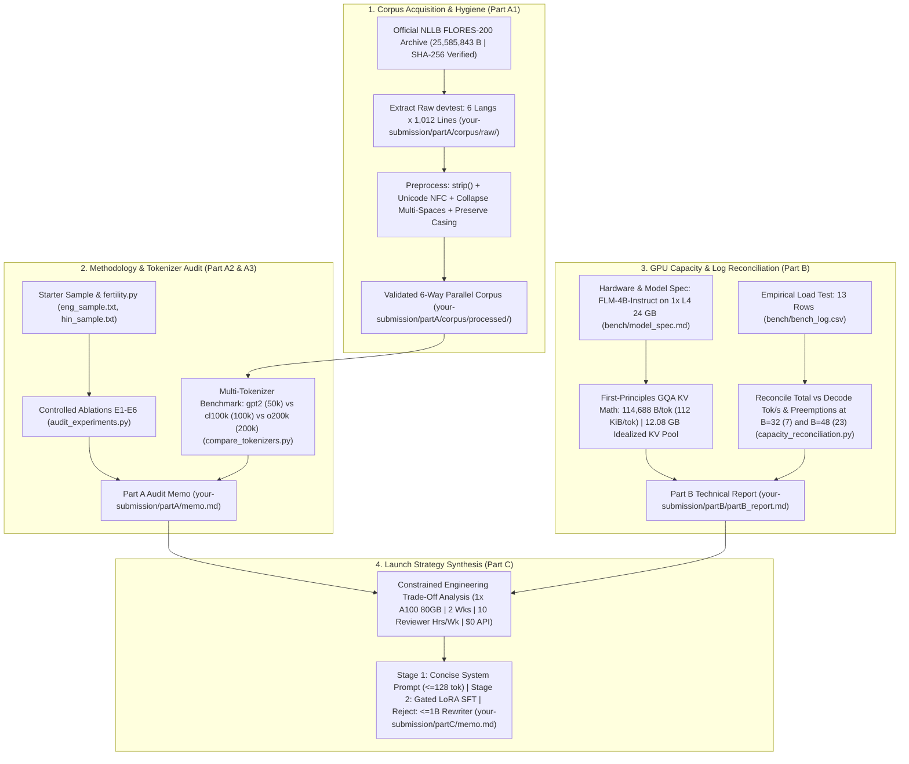
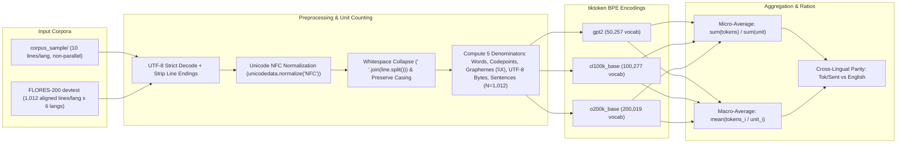
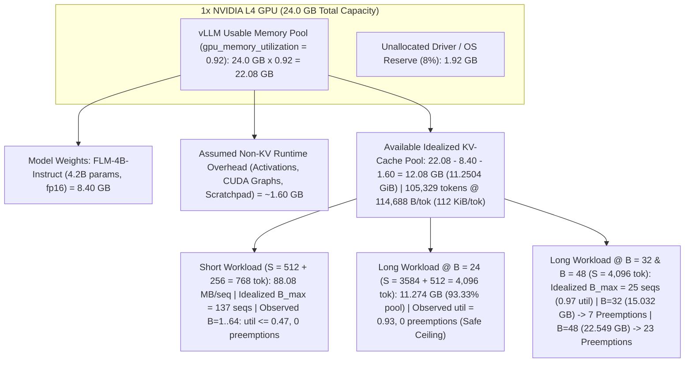
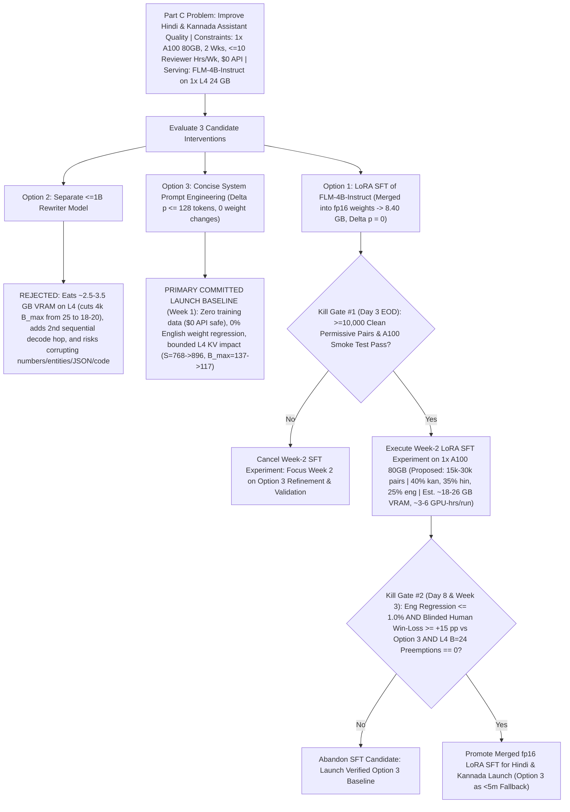
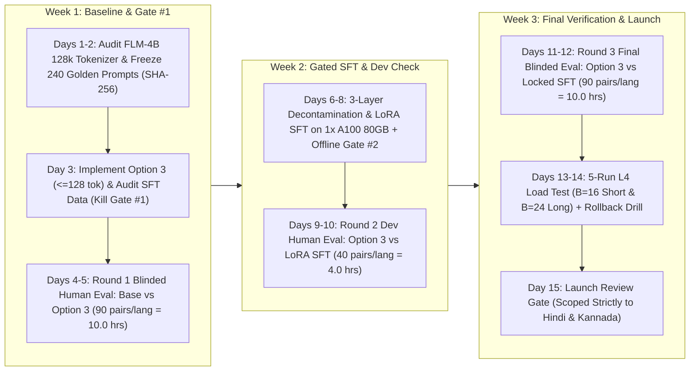

# The Audit — AI Team Intern Technical Assignment

-3776AB?logo=python&logoColor=white)


-F9AB00)


An end-to-end technical audit of a flawed leadership deck ([`REPORT_v0.md`](REPORT_v0.md)), a defective tokenizer benchmark script ([`fertility.py`](fertility.py)), and an empirical LLM serving log ([`bench/bench_log.csv`](bench/bench_log.csv)) for **FLM-4B-Instruct (`4.2B`)** on an **NVIDIA L4 (24 GB)** GPU, followed by an evidence-gated engineering plan for launching Hindi and Kannada assistant support under strict hardware, timeline, budget, and human-reviewer constraints.

---

## Table of Contents

1. [Problem Statement and Motivation](#1-problem-statement-and-motivation)
2. [Project Objectives and Evaluation Criteria](#2-project-objectives-and-evaluation-criteria)
3. [Repository Structure](#3-repository-structure)
4. [System Workflow and Architecture](#4-system-workflow-and-architecture)
5. [Part A — Multilingual Tokenizer Audit (50 Points)](#5-part-a--multilingual-tokenizer-audit-50-points)
6. [Part B — GPU Capacity and Throughput Reconciliation (20 Points)](#6-part-b--gpu-capacity-and-throughput-reconciliation-20-points)
7. [Part C — Engineering Recommendation (15 Points)](#7-part-c--engineering-recommendation-15-points)
8. [Numerical Results and Key Findings](#8-numerical-results-and-key-findings)
9. [Evaluation Methodology and Limitations](#9-evaluation-methodology-and-limitations)
10. [Reproducibility: Environment Setup and Execution Commands](#10-reproducibility-environment-setup-and-execution-commands)
11. [Assumptions, Risks, and Unresolved Questions](#11-assumptions-risks-and-unresolved-questions)
12. [Final Conclusions and Future Work](#12-final-conclusions-and-future-work)

---

## 1. Problem Statement and Motivation

Before a high-visibility product review, a previous intern prepared [`REPORT_v0.md`](REPORT_v0.md) (*"Tokenizer & Serving Findings (v0) — for the leadership deck"*), accompanied by [`fertility.py`](fertility.py), a 10-line sample corpus ([`corpus_sample/`](corpus_sample/)), and a serving benchmark directory ([`bench/`](bench/)).

[`REPORT_v0.md`](REPORT_v0.md) makes two sweeping operational recommendations that, if accepted uncritically, would misallocate engineering effort and cause production outages:

1. **Tokenizer Claim ([`REPORT_v0.md` §1](REPORT_v0.md)):** Claims Hindi fertility is **`5.89×` worse** per word (`7.45` vs. `1.27 tok/word`) and **`7.00×` worse** per character (`1.579` vs. `0.226 tok/char`) than English because *"Hindi simply has more Unicode characters per word, so any tokenizer will struggle. This is a property of the script, not the tokenizer."* It recommends budgeting **`6×` serving cost** for Hindi and routing all Indic traffic to a separate model without further measurement.
2. **Serving Capacity Claim ([`REPORT_v0.md` §2](REPORT_v0.md)):** Observes that at `batch_size = 16`, `reported_tok_s` is **`1,311.4 tok/s`** for long prompts (`prompt_len = 3584, gen_len = 512`) versus **`883.2 tok/s`** for short prompts (`prompt_len = 512, gen_len = 256`), and concludes that *"longer prompts clearly give better GPU utilization"* and that scaling linearly to `batch_size = 48` should deliver **`~3,200 tok/s`** on a single **NVIDIA L4 (24 GB)** GPU.

In addition, leadership needs a defensible 3-week launch plan (**Part C**) to fix "too formal / textbook" Hindi and Kannada assistant outputs using **1× NVIDIA A100 (80 GB)** for R&D, **2 weeks** of implementation/evaluation time, **10 hours/week** of combined Hindi and Kannada human reviewer capacity, and a **`$0` external API budget**.

---

## 2. Project Objectives and Evaluation Criteria

This repository executes a rigorous, reproducible audit across four deliverables:

| Component | Weight | Core Audit Objective | Primary Deliverables |
| :--- | :---: | :--- | :--- |
| **Part A — Tokenizer Audit** | **50 pts** | Build a clean $\ge 500$-sentence multi-way parallel Indic+English corpus (**A1**); run controlled single-variable ablations (`E1–E6`) on [`fertility.py`](fertility.py) (**A2**); benchmark multiple tokenizers across 5 denominators (**A3**); write a 1-page leadership memo (**A4**). | [`build_corpus.py`](your-submission/partA/build_corpus.py), [`audit_experiments.py`](your-submission/partA/audit_experiments.py), [`compare_tokenizers.py`](your-submission/partA/compare_tokenizers.py), [`partA/memo.md`](your-submission/partA/memo.md) |
| **Part B — Capacity Reconciliation** | **20 pts** | Derive KV-cache memory from first principles using [`bench/model_spec.md`](bench/model_spec.md) (**B1**); reconcile all 13 rows of [`bench/bench_log.csv`](bench/bench_log.csv), expose the `reported_tok_s` metric flaw, and explain preemptions at $B=32, 48$ (**B2–B3**). | [`capacity_reconciliation.py`](your-submission/partB/capacity_reconciliation.py), [`partB_report.md`](your-submission/partB/partB_report.md), [`partB_reconciliation.json`](your-submission/partB/partB_reconciliation.json) |
| **Part C — Engineering Recommendation** | **15 pts** | Evaluate Supervised Fine-Tuning (SFT), a $\le 1\text{B}$ rewriter model, and prompt engineering under strict compute, reviewer, timeline, and `$0` API constraints. | [`partC/memo.md`](your-submission/partC/memo.md) |
| **Lab Notebook & AI Disclosure** | **15 pts** | Maintain a chronological engineering lab notebook of hypotheses, commands, dead ends, and verifications, plus a transparent audit of AI tool errors caught and fixed. | [`NOTEBOOK.md`](your-submission/NOTEBOOK.md), [`AI_USAGE.md`](your-submission/AI_USAGE.md), [`FINAL_AUDIT_REPORT.md`](your-submission/FINAL_AUDIT_REPORT.md) |

---

## 3. Repository Structure

All original starter-kit files remain unmodified at the repository root. Completed audit artifacts reside in [`your-submission/`](your-submission/) (and are mirrored byte-for-byte in [`my-submission/`](my-submission/) for grading compatibility):

```text
starter_kit/
├── README.md                                           # Visual, data-driven project documentation (this file)
├── REPORT_v0.md                                        # [Original Input] Flawed v0 leadership deck under audit
├── fertility.py                                        # [Original Input] Starter-kit tokenizer fertility script (v0)
├── corpus_sample/                                      # [Original Input] 10-line non-parallel smoke-test sample
│   ├── eng_sample.txt                                  # 10 English sentences (78 split() words, 448 codepoints)
│   └── hin_sample.txt                                  # 10 Hindi sentences (61 split() words, 290 codepoints)
├── bench/                                              # [Original Input] Serving specification & load-test logs
│   ├── model_spec.md                                   # FLM-4B-Instruct (4.2B) & 1x NVIDIA L4 (24 GB) spec
│   └── bench_log.csv                                   # 13-row empirical load-test log (short 512/256 & long 3584/512)
│
├── your-submission/                                    # [Canonical Submission Directory]
│   ├── NOTEBOOK.md                                     # Chronological engineering lab notebook (Entries 1–14)
│   ├── AI_USAGE.md                                     # AI tool usage disclosure & human verification log
│   ├── FINAL_AUDIT_REPORT.md                           # Master rubric compliance & cross-file verification report
│   ├── MENTOR_REPORT.md                                # Concise technical walkthrough for mentor/interview review
│   │
│   ├── partA/                                          # Part A: Multilingual Tokenizer Audit (50 pts)
│   │   ├── memo.md                                     # A4: One-page executive tokenizer audit memo
│   │   ├── a4_recommendation_memo.md                   # Byte-identical copy of memo.md
│   │   ├── build_corpus.py                             # A1: Deterministic FLORES-200 devtest builder & validator
│   │   ├── corpus_documentation.md                     # A1: Provenance, licensing (CC-BY-SA-4.0), & preprocessing
│   │   ├── corpus_validation_output.txt                # A1: Console stdout of build_corpus.py
│   │   ├── audit_experiments.py                        # A2: Single-variable controlled ablations E1–E6 on fertility.py
│   │   ├── e1_e6_raw_output.txt                        # A2: Console stdout of audit_experiments.py
│   │   ├── audit_results.md                            # A2: Detailed methodology & code audit report
│   │   ├── compare_tokenizers.py                       # A3: 6-language x 3-tokenizer x 5-denominator benchmark
│   │   ├── a3_tokenizer_comparison_output.txt          # A3: Console stdout of compare_tokenizers.py
│   │   ├── a3_tokenizer_comparison.json                # A3: Full machine-readable benchmark telemetry
│   │   ├── a3_analysis.md                              # A3: Cross-tokenizer & morphological analysis report
│   │   └── corpus/
│   │       ├── flores200_dataset.tar.gz                # Cached official NLLB FLORES-200 archive (25,585,843 B)
│   │       ├── corpus_validation_summary.json          # Structured JSON validation metrics (sample, raw, processed)
│   │       ├── raw/                                    # Unmodified upstream devtest files + metadata_devtest.tsv
│   │       │   ├── {eng,hin,tam,tel,kan,mal}.txt       # 1,012 raw sentences per language
│   │       │   ├── metadata_devtest.tsv                # Source URLs (281 articles), domains, and topic tags
│   │       │   └── README                              # Upstream FLORES-200 archive README
│   │       └── processed/                              # Normalized corpus (UTF-8, NFC, collapsed internal spaces, cased)
│   │           └── {eng,hin,tam,tel,kan,mal}.txt       # 1,012 aligned sentences per language (6,072 total)
│   │
│   ├── partB/                                          # Part B: GPU Capacity & Throughput Reconciliation (20 pts)
│   │   ├── capacity_reconciliation.py                  # B1–B3: First-principles KV-cache & 13-row benchmark verifier
│   │   ├── partB_calculation_output.txt                # Console stdout of capacity_reconciliation.py
│   │   ├── partB_reconciliation.json                   # Machine-readable capacity & sensitivity tables
│   │   └── partB_report.md                             # Detailed technical report reconciling bench_log.csv
│   │
│   └── partC/                                          # Part C: Engineering Recommendation Memo (15 pts)
│       └── memo.md                                     # Risk-adjusted 3-week plan (Option 3 primary + gated Option 1)
│
└── my-submission/                                      # Byte-for-byte identical mirror of your-submission/ (37 files)
```

---

## 4. System Workflow and Architecture

### Diagram A — End-to-End Audit Workflow



---

## 5. Part A — Multilingual Tokenizer Audit (50 Points)

### Diagram B — Part A Tokenizer Audit Pipeline



### 5.1 Part A1 — FLORES-200 Parallel Corpus Construction & Validation
The starter kit's [`corpus_sample/`](corpus_sample/) contains only `10` lines per language, has **`0/10` line-index alignment**, and leaves `5/10` sentences with no semantic counterpart in the other file. To establish a rigorous benchmark, [`build_corpus.py`](your-submission/partA/build_corpus.py) extracts the official **FLORES-200 `devtest`** split (`1,012` human-translated multi-way parallel sentences per language across `281` Wikimedia articles under `CC-BY-SA-4.0`) across **6 languages** spanning 2 language families and 6 scripts:

| Code | FLORES ID | Language | Family & Morphological Typology | Script | Lines | Words (`split()`) | Unicode Codepoints | Graphemes (`\X`) | UTF-8 Line Bytes | CP / Word | Graphemes / Word | Bytes / Codepoint |
| :--- | :--- | :--- | :--- | :--- | ---: | ---: | ---: | ---: | ---: | ---: | ---: | ---: |
| **`eng`** | `eng_Latn` | English | Indo-European (Analytic) | Latin | `1,012` | `21,901` | `131,966` | `131,966` | `132,096` | `6.03` | `6.03` | `1.0010` |
| **`hin`** | `hin_Deva` | Hindi | Indo-European (Analytic / Postpositional) | Devanagari | `1,012` | `25,643` | `131,174` | `85,951` | `337,433` | `5.12` | `3.35` | `2.5724` |
| **`tam`** | `tam_Taml` | Tamil | Dravidian (Agglutinative) | Tamil | `1,012` | `16,775` | `154,031` | `99,624` | `421,535` | `9.18` | `5.94` | `2.7367` |
| **`tel`** | `tel_Telu` | Telugu | Dravidian (Agglutinative) | Telugu | `1,012` | `16,938` | `132,226` | `76,328` | `353,422` | `7.81` | `4.51` | `2.6729` |
| **`kan`** | `kan_Knda` | Kannada | Dravidian (Agglutinative) | Kannada | `1,012` | `16,100` | `137,650` | `89,994` | `374,964` | `8.55` | `5.59` | `2.7240` |
| **`mal`** | `mal_Mlym` | Malayalam | Dravidian (Highly Agglutinative) | Malayalam | `1,012` | `14,930` | `149,261` | `79,357` | `411,670` | `10.00` | `5.32` | `2.7581` |

#### Before-vs-After Preprocessing Hygiene (`raw/` vs. `processed/`)
Inspecting the unmodified upstream FLORES-200 files in [`your-submission/partA/corpus/raw/`](your-submission/partA/corpus/raw/) revealed two upstream anomalies that [`build_corpus.py`](your-submission/partA/build_corpus.py) deterministically resolves in [`your-submission/partA/corpus/processed/`](your-submission/partA/corpus/processed/):
1. **Consecutive Internal Spaces (`"  "`):** Present in **`213` Kannada lines** (`+477` phantom empty words under `split(" ")`), **`136` Telugu lines** (`+274` phantom words), **`75` Tamil lines** (`+100`), **`54` Malayalam lines** (`+71`), and **`6` Hindi lines** (`+27`), versus `0` in English. Collapsing internal whitespace via `" ".join(s.split())` eliminates all `949` phantom words across the corpus.
2. **Non-NFC Unicode Sequences (`107` lines total):**
   - In raw Hindi (`hin_Deva.devtest`), **`93` lines** contain precomposed Devanagari *nukta* singletons (`U+0958`–`U+095F`, such as `U+095B` `ज़` and `U+095C` `ड़`), which are **Unicode Canonical Composition Exclusions** that canonically decompose under `NFC` into base consonant + `U+093C` combining nukta (`+122` codepoints across those `93` lines).
   - In raw Dravidian files, **`14` lines** (`7` `kan`, `4` `mal`, `2` `tam`, `1` `tel`) contain decomposed two-part vowel signs that canonically compose under `NFC` (`-13` codepoints in `kan`, `-5` in `tel`, `-4` in `mal`, `-2` in `tam`).

### 5.2 Part A2 — Controlled Ablations (`E1–E6`) on `fertility.py`
Running [`audit_experiments.py`](your-submission/partA/audit_experiments.py) isolates each methodological flaw in [`fertility.py`](fertility.py) on the 10-line starter sample (full output in [`e1_e6_raw_output.txt`](your-submission/partA/e1_e6_raw_output.txt) and [`audit_results.md`](your-submission/partA/audit_results.md)):

| Experiment | Single Variable Changed vs. Baseline (`fertility.py`) | Measured `eng` Fertility | Measured `hin` Fertility | `hin / eng` Fertility Ratio | Key Technical Finding |
| :--- | :--- | :---: | :---: | :---: | :--- |
| **Baseline (`v0`)** | Unmodified [`fertility.py`](fertility.py) (`lower()`, `split(" ")`, macro-avg) | `1.2652` (`1.27`) | `7.4485` (`7.45`) | **`5.8871×` (`5.89×`)** | Reproduces [`REPORT_v0.md`](REPORT_v0.md) table (`1.27`, `7.45`, `5.89×`, `tok/char = 7.00×`). |
| **`E1` (Word Split)** | `line.split(" ")` $\rightarrow$ `line.split()` | `1.2831` (`1.28`) | `7.5985` (`7.60`) | **`5.9221×` (`5.92×`, `+0.59%`)** | Double spaces on `eng L07` (`"books  in"`) and `hin L10` (`"किताबें  अलमारी"`) created empty `""` words in `split(" ")`, artificially deflating fertility by `-1.41%` (`eng`) and `-2.01%` (`hin`). |
| **`E2` (Casing)** | Remove `line.lower()` (keep original casing) | `1.2293` (`1.23`) | `7.4485` (`7.45`) | **`6.0590×` (`6.06×`, `+2.92%`)** | `line.lower()` breaks `gpt2` cased BPE merges on English proper nouns/acronyms (`"Thursday"` $1\to 2$ tok, `"NASA"` $1\to 2$ tok, `"GPU"` $1\to 2$ tok; `96` $\rightarrow$ `99` tokens), while unicameral Devanagari is `0.00%` affected (`459` tokens). |
| **`E3` (Aggregation)** | Line macro-average $\rightarrow$ Corpus micro-average (`tot_tok / tot_words`) | `1.2532` (`1.25`) | `7.4032` (`7.40`) | **`5.9076×` (`5.91×`, `+0.35%`)** | Unweighted mean of ratios $\frac{1}{N}\sum \frac{T_i}{W_i}$ overweights short lines relative to true corpus ratio $\frac{\sum T_i}{\sum W_i}$. |
| **`E4a` (`tok/byte`)** | Denominator: `len(line)` codepoints $\rightarrow$ `len(line.encode("utf-8"))` bytes | `0.2256` (`0.226`) | `0.5990` (`0.599`) | **`2.6547×` (`2.65×`, `-62.07%`)** | Proves `2.63×` of the `7.00×` `tok/char` gap is simply UTF-8 `3`-byte/codepoint encoding of Devanagari (`764 B / 290 cp`) vs. `1`-byte ASCII (`448 B / 448 cp`). |
| **`E4b` (`tok/grapheme`)** | Denominator: `len(line)` codepoints $\rightarrow$ `regex.findall(r"\X", line)` graphemes | `0.2256` (`0.226`) | `2.4497` (`2.450`) | **`10.8570×` (`10.86×`, `+55.13%`)** | Combining vowel *matras*, *halants*, and *anusvara* mean `290` Hindi codepoints form only `188` visible orthographic syllables (`\X`). Also refutes [`REPORT_v0.md`](REPORT_v0.md) Finding #3: Hindi actually has **fewer** codepoints/word (`4.75`) and graphemes/word (`3.08`) than English (`5.74`). |
| **`E5` (Alignment)** | Full 10-line non-parallel sample $\rightarrow$ 5 loosely matched semantic pairs | `1.2286` (`1.23`) | `7.5857` (`7.59`) | **`6.1744×` (`6.17×`, `+4.88%`)** | Only 5 pairs correspond semantically (out of order: `L03↔L03`, `L04↔L07`, `L05↔L06`, `L07↔L10`, `L08↔L04`), shifting total token ratio (`hin_tok/eng_tok`) by **`+11.06%`** (`4.64×` $\rightarrow$ `5.15×`). |
| **`E6` (Harmless Checks)** | Test `random.seed(1337)`, `NFC` on `corpus_sample/`, and `add_special_tokens=False` | `1.2652` (`1.27`) | `7.4485` (`7.45`) | **`5.8871×` (`5.89×`, `0.00%`)** | `random` is never called by `analyze()`; `corpus_sample/` is already 100% `NFC`; `tiktoken.encode()` adds `0` special tokens. |
| **Combined Fix** | `split()` + Cased + Micro-average on 10-line sample | `1.2308` (`1.23`) | `7.5246` (`7.52`) | **`6.1137×` (`6.11×`, `+3.85%`)** | Fixing all code bugs simultaneously shifts the sample fertility ratio from `5.89×` to `6.11×` and `tok/char` ratio from `7.00×` to `7.39×` (`+5.54%`). |

### 5.3 Part A3 — Multi-Tokenizer Comparison (`gpt2` vs. `cl100k_base` vs. `o200k_base`)
Running [`compare_tokenizers.py`](your-submission/partA/compare_tokenizers.py) across all `1,012` aligned FLORES-200 sentences per language (`6,072` total sentences) directly refutes [`REPORT_v0.md`](REPORT_v0.md)'s claim that *"any tokenizer will struggle"*:

| Language | `gpt2` Tokens (`50k` vocab) | `cl100k_base` Tokens (`100k` vocab) | `o200k_base` Tokens (`200k` vocab) | Reduction (`gpt2` $\rightarrow$ `o200k_base`) | `gpt2` `Tok/Word` (`Tok/Sent` Parity) | `cl100k_base` `Tok/Word` (`Tok/Sent` Parity) | `o200k_base` `Tok/Word` (`Tok/Sent` Parity) |
| :--- | ---: | ---: | ---: | ---: | :---: | :---: | :---: |
| **English (`eng`)** | `27,044` | `27,182` | `26,873` | **`0.63%`** (`1.01×` less) | `1.235` (`1.00×`) | `1.241` (`1.00×`) | `1.227` (`1.00×`) |
| **Hindi (`hin`)** | `200,682` | `129,567` | `42,241` | **`78.95%`** (`4.75×` less) | `7.826` (`7.42×`) | `5.053` (`4.77×`) | `1.647` (**`1.57×`**) |
| **Tamil (`tam`)** | `420,071` | `207,687` | `53,114` | **`87.36%`** (`7.91×` less) | `25.041` (`15.53×`) | `12.381` (`7.64×`) | `3.166` (**`1.98×`**) |
| **Telugu (`tel`)** | `350,509` | `225,022` | `51,610` | **`85.28%`** (`6.79×` less) | `20.694` (`12.96×`) | `13.285` (`8.28×`) | `3.047` (**`1.92×`**) |
| **Kannada (`kan`)** | `366,989` | `240,364` | `52,534` | **`85.69%`** (`6.99×` less) | `22.794` (`13.57×`) | `14.929` (`8.84×`) | `3.263` (**`1.95×`**) |
| **Malayalam (`mal`)** | `409,912` | `242,859` | `52,515` | **`87.19%`** (`7.81×` less) | `27.456` (`15.16×`) | `16.267` (`8.93×`) | `3.517` (**`1.95×`**) |

```mermaid
xychart-beta
    title "Tokens per Aligned Sentence (FLORES-200 devtest, N=1,012): gpt2 vs cl100k_base vs o200k_base"
    x-axis ["English (eng)", "Hindi (hin)", "Telugu (tel)", "Kannada (kan)", "Malayalam (mal)", "Tamil (tam)"]
    y-axis "Tokens per Sentence (tok/sent)" 0 --> 450
    bar [26.72, 198.30, 346.35, 362.64, 405.05, 415.09]
    bar [26.86, 128.03, 222.35, 237.51, 239.98, 205.22]
    bar [26.55, 41.74, 51.00, 51.91, 51.89, 52.48]
```


*(In the chart above: Series 1 = `gpt2`, Series 2 = `cl100k_base`, Series 3 = `o200k_base`.)*

#### Why `Tok/Word` Is Misleading Across Morphological Families (and Why `Tok/Sent` Is Primary)
- **Agglutination vs. Analytic Spacing:** Across the exact same `1,012` semantic propositions, Hindi uses **`25,643` words** (analytic postpositions like `में`, `को`, `से` written as separate words), English uses **`21,901` words**, and agglutinative Dravidian languages pack suffixes onto stems to use only **`14,930` (`mal`) to `16,938` (`tel`) words**.
- Because Dravidian languages have `23%–32%` fewer whitespace words for the same meaning, dividing tokens by `words` (`Tok/Word`) artificially inflates Dravidian fertility (`2.48×–2.87×` English on `o200k_base`) even when **tokens per aligned sentence (`Tok/Sent`)**—which determines actual LLM context window and KV-cache consumption for equivalent propositional content—is only **`1.92×–1.98×` English** (`51.00–52.48` vs. `26.55 tok/sent`).
- **Critical Epistemic Distinction:** Higher tokenizer compression (`o200k_base` reducing Indic token counts by `78.95%–87.36%` vs. `gpt2`) directly reduces sequence length $S$ for a fixed input text, **but does not automatically prove superior downstream model generation quality, lower end-to-end latency on a different model, or lower production cost** unless the serving model shares that tokenizer and is empirically benchmarked.

---

## 6. Part B — GPU Capacity and Throughput Reconciliation (20 Points)

### Diagram C — NVIDIA L4 (24 GB) GPU Memory Architecture & KV-Cache Scaling



### 6.1 First-Principles KV-Cache Derivation (Analytical Estimate)
From [`bench/model_spec.md`](bench/model_spec.md), `FLM-4B-Instruct` uses **Grouped-Query Attention (GQA)** with $L = 28$ layers, $n_q = 24$ query heads, **$n_{kv} = 8$ KV heads** (3:1 GQA sharing), $d_h = 128$ head dimension, and `fp16` (`2` bytes/element) for both weights and KV cache:

$$\text{KV bytes/token} = 2 \times \text{layers} \times \text{KV heads} \times \text{head dimension} \times \text{bytes per element}$$

$$\text{KV bytes/token} = 2 \times 28 \times 8 \times 128 \times 2 = \mathbf{114{,}688\text{ bytes/token}} = \mathbf{112.0\text{ KiB/token}} \approx 0.114688\text{ MB/token}$$

- ** Variable Definitions:**
  - `2`: Key ($K$) and Value ($V$) state tensors stored per attention layer.
  - `layers` ($L = 28$): Number of transformer blocks in `FLM-4B-Instruct`.
  - `KV heads` ($n_{kv} = 8$): Number of Grouped-Query Attention key/value heads per layer *(Note: using $n_q = 24$ query heads is a common Multi-Head Attention error that overestimates KV size by $3\times$ at `344,064 B = 336 KiB/tok`)*.
  - `head dimension` ($d_h = 128$): Hidden dimension per attention head ($d_{\text{model}} / n_q = 3072 / 24 = 128$).
  - `bytes per element` ($b = 2$): `fp16` precision (`2` bytes per scalar).

#### Idealized Memory Budget & Token Capacity on `1× NVIDIA L4 (24 GB)`
Applying the decimal GB convention from [`bench/model_spec.md`](bench/model_spec.md) (verified across all 13 rows in [`capacity_reconciliation.py`](your-submission/partB/capacity_reconciliation.py)):

| Parameter / Step | Analytical Calculation | Value (Decimal / Binary) | Classification |
| :--- | :--- | :--- | :--- |
| **Total GPU Memory** | `1× NVIDIA L4` | `24.00 GB` (`22.3517 GiB`) | Hardware Spec ([`model_spec.md`](bench/model_spec.md)) |
| **Usable vLLM Memory (`0.92`)** | $24.00\text{ GB} \times 0.92$ | `22.08 GB` (`20.5636 GiB`) | Serving Config ([`model_spec.md`](bench/model_spec.md)) |
| **Model Weights (`4.2B` `fp16`)** | $4.2 \times 10^9 \times 2\text{ B}$ | `-8.40 GB` (`-7.8231 GiB`) | Analytical Calculation |
| **Non-KV Runtime Overhead** | Activations, CUDA graphs, scratchpad | `-1.60 GB` (`-1.4901 GiB`) | Stated Assumption ([`model_spec.md`](bench/model_spec.md)) |
| **Available Idealized KV Pool** | $22.08 - 8.40 - 1.60$ | **`12.08 GB`** (`11.2504 GiB`) | Analytical Estimate |
| **Theoretical Token Capacity** | $\lfloor 12{,}080{,}000{,}000 / 114{,}688 \rfloor$ | **`105,329 tokens`** | Analytical Estimate |
| **Per-Seq KV @ Short (`S = 768`)** | $768 \times 114{,}688\text{ B}$ | `88.08 MB` (`84.00 MiB`) | Analytical Calculation |
| **Per-Seq KV @ Long (`S = 4,096`)** | $4{,}096 \times 114{,}688\text{ B}$ | `469.76 MB` (`448.00 MiB`) | Analytical Calculation |
| **Idealized Max Batch @ `S = 768`** | $\lfloor 105{,}329 / 768 \rfloor$ (`137.147`) | **`137 sequences`** | Idealized Analytical Estimate |
| **Idealized Max Batch @ `S = 4,096`** | $\lfloor 105{,}329 / 4{,}096 \rfloor$ (`25.715`) | **`25 sequences`** | Idealized Analytical Estimate *(allocator/block fragmentation may reduce actual capacity)* |

### 6.2 Complete 13-Row Reconciliation of `bench/bench_log.csv`
Running [`capacity_reconciliation.py`](your-submission/partB/capacity_reconciliation.py) reconciles every row of [`bench/bench_log.csv`](bench/bench_log.csv):

| Row | `batch_size` ($B$) | `prompt_len` ($p$) | `gen_len` ($g$) | `wall_clock_s` | `reported_tok_s` (Log) | `calc_total_tok_s` $\frac{N(p+g)}{T}$ | `calc_gen_tok_s` $\frac{Ng}{T}$ | Multiplier $\frac{p+g}{g}$ | Peak KV Demand (GB) | Idealized KV Util | Logged `kv_cache_util` | Preemptions (Ideal / Log) | `ttft_ms_p50` | `itl_ms_p50` | Est. Model Traffic BW (GB/s)* |
| --: | --: | ---: | --: | ---: | ---: | ---: | ---: | :---: | ---: | ---: | ---: | :---: | ---: | ---: | ---: |
| **1** | `1` | `512` | `256` | `10.94` | `70.2` | `70.20` | **`23.40`** | `3.0×` | `0.088` | `0.0073` | `0.01` | `0 / 0` | `71.1` | `43.48` | `194.9` |
| **2** | `2` | `512` | `256` | `11.61` | `132.3` | `132.30` | **`44.10`** | `3.0×` | `0.176` | `0.0146` | `0.01` | `0 / 0` | `68.3` | `43.10` | `198.3` |
| **3** | `4` | `512` | `256` | `11.77` | `261.0` | `261.00` | **`87.00`** | `3.0×` | `0.352` | `0.0292` | `0.03` | `0 / 0` | `71.5` | `45.34` | `191.7` |
| **4** | `8` | `512` | `256` | `12.40` | `495.4` | `495.48` | **`165.16`** | `3.0×` | `0.705` | `0.0583` | `0.06` | `0 / 0` | `72.7` | `46.83` | `191.9` |
| **5** | `16` | `512` | `256` | `13.91` | `883.2` | `883.39` | **`294.46`** | `3.0×` | `1.409` | `0.1167` | `0.12` | `0 / 0` | `71.7` | `48.33` | `198.1` |
| **6** | `32` | `512` | `256` | `16.50` | `1489.6` | `1489.45` | **`496.48`** | `3.0×` | `2.819` | `0.2333` | `0.23` | `0 / 0` | `68.3` | `56.17` | `191.4` |
| **7** | `64` | `512` | `256` | `21.68` | `2267.3` | `2267.16` | **`755.72`** | `3.0×` | `5.637` | `0.4667` | `0.47` | `0 / 0` | `73.3` | `67.91` | `192.9` |
| **8** | `4` | `3584` | `512` | `28.98` | `565.4` | `565.36` | **`70.67`** | `8.0×` | `1.879` | `0.1556` | `0.16` | `0 / 0` | `483.2` | `51.33` | `198.0` |
| **9** | `8` | `3584` | `512` | `36.30` | `902.6` | `902.70` | **`112.84`** | `8.0×` | `3.758` | `0.3111` | `0.31` | `0 / 0` | `519.0` | `62.26` | `191.5` |
| **10** | `16` | `3584` | `512` | `49.97` | `1311.4` | `1311.51` | **`163.94`** | `8.0×` | `7.516` | `0.6222` | `0.62` | `0 / 0` | `498.3` | `77.20` | `200.1` |
| **11** | `24` | `3584` | `512` | `61.16` | `1607.4` | `1607.33` | **`200.92`** | `8.0×` | `11.274` | `0.9333` | `0.93` | `0 / 0` | `500.5` | `96.07` | `197.5` |
| **12** | `32` | `3584` | `512` | `94.71` | `1384.0` | `1383.93` | **`172.99`** | `8.0×` | `15.032` | `0.9722` (cap) | `0.97` | **`7 / 7`** | `636.9` | `101.79` | `190.7` |
| **13** | `48` | `3584` | `512` | `151.41` | `1298.5` | `1298.51` | **`162.31`** | `8.0×` | `22.549` | `0.9722` (cap) | `0.97` | **`23 / 23`** | `955.4` | `100.00` | `194.1` |

*\*Note on Est. Model Traffic BW (`190.7–200.1 GB/s`): These figures are analytical traffic-model estimates derived from `(weights + avg_active_KV) / itl_ms_p50`, not hardware-measured HBM telemetry. Confirming actual L4 memory-bus saturation requires NVIDIA Nsight Compute (`ncu`) or DCGM `DRAM_ACTIVE` profiling.*

#### Why [`REPORT_v0.md`](REPORT_v0.md) §2 Is Wrong: The `reported_tok_s` Illusion & Preemption Cliff
1. **`reported_tok_s` Includes Prefill Input Tokens:** In every row, `reported_tok_s` equals $\frac{\texttt{num\_requests} \times (\texttt{prompt\_len} + \texttt{gen\_len})}{\texttt{wall\_clock\_s}}$. Because the long-prompt workload has a $(3584+512)/512 = \mathbf{8.0\times}$ total-to-output multiplier vs. $(512+256)/256 = \mathbf{3.0\times}$ for the short workload, `reported_tok_s` at $B=16$ looks higher on long prompts (`1,311.4` vs. `883.2 tok/s`) even though **actual generated output throughput (`calc_gen_tok_s`) is `44.33%` lower** (`163.94` vs. `294.46 gen tok/s`) and median decode latency (`itl_ms_p50`) is **`+59.74%` slower** (`77.20 ms` vs. `48.33 ms`). *(Note: Rows 5 and 10 change both `prompt_len` and `gen_len`, so this comparison reflects the combined workload shift.)*
2. **Why Batch 24 Fits While Batch 32 and 48 Preempt:** At $S = 4{,}096$ tokens, the `12.08 GB` idealized KV pool holds at most $\lfloor 105{,}329 / 4{,}096 \rfloor = \mathbf{25}$ concurrent sequences (`25 / 25.715 = 0.9722` $\rightarrow$ `0.97` peak utilization).
   - At **`batch_size = 24` (Row 11):** Peak KV demand is `11.274 GB` (`93.33%` $\rightarrow$ `kv_cache_util = 0.93`), fitting with **`0` preemptions** and achieving peak long-context decode throughput (`200.92 gen tok/s`).
   - At **`batch_size = 32` (Row 12):** Peak KV demand is `15.032 GB` (`124.44%` of pool), exceeding idealized capacity by $32 - 25 = \mathbf{7}$ sequences—matching `preempted_seqs = 7` and `kv_cache_util = 0.97`!
   - At **`batch_size = 48` (Row 13):** Peak KV demand is `22.549 GB` (`186.66%` of pool), exceeding idealized capacity by $48 - 25 = \mathbf{23}$ sequences—matching `preempted_seqs = 23` and collapsing throughput to `1,298.5 total tok/s` (`162.31 gen tok/s`), refuting [`REPORT_v0.md`](REPORT_v0.md)'s linear extrapolation of `~3,200 tok/s`.

---

## 7. Part C — Engineering Recommendation (15 Points)

### Diagram D — Part C Staged Engineering Decision Flowchart



### Diagram E — 3-Week Experiment, Evaluation, and Launch Lifecycle



### Summary of the Part C Engineering Recommendation ([`your-submission/partC/memo.md`](your-submission/partC/memo.md))
Rather than gambling the 3-week launch solely on an unverified fine-tuning dataset or assuming prompt engineering can fix deep morphological deficits, [`partC/memo.md`](your-submission/partC/memo.md) establishes a **staged, two-gate decision architecture**:

1. **Primary Committed Launch Path — Option 3 (Concise System-Prompt Engineering, $\Delta p \le 128$ tokens):**
   - **Why Primary:** No SFT dataset exists in the starter kit, and the `$0` API budget prohibits commercial synthetic data generation. Concise language-routed system prompts ($\Delta p \le 128$ tokens) require zero training data, preserve `FLM-4B-Instruct`'s exact English weights (`0%` catastrophic forgetting risk), and keep short-turn L4 concurrency well above peak load ($S = 768 \rightarrow 896$ tokens shifts idealized $B_{\max}$ from `137` to `117` sequences, safe for $B \le 64$).
2. **Conditional Week-2 Experimental Upgrade — Option 1 (LoRA SFT of `FLM-4B-Instruct`, Merged to `fp16`):**
   - **Why Gated:** Executed in Week 2 **only if** Day 3's **Kill Gate #1** confirms $\ge 10,000$ clean, decontaminated, permissively licensed (`Apache-2.0` / `CC-BY-4.0`) conversational/instruction pairs exist locally. If promoted after merging into `fp16` weights ($W' = W_0 + \frac{\alpha}{r}BA$), it adds **`0` extra weight bytes** (`8.40 GB`) and **`0` system-prompt tokens** ($\Delta p = 0$) on the L4 GPU.
   - **Planned Training & Evaluation Parameters *(Proposed Plan / Analytical Estimates, Not Executed)*:**
     - *Proposed Data Mixture:* `15,000–30,000` examples (`40%` Kannada, `35%` Hindi, `25%` English replay buffer), filtered via a 3-layer decontamination pipeline (NFC substring, 13-gram overlap, and 5-gram MinHash Jaccard $\ge 0.70$).
     - *Estimated A100 Training Cost:* `~18–26 GB` VRAM (`bf16`/`fp16` base weights + LoRA $r=16, \alpha=32$ + checkpointed activations at $S \le 2048$) and **`~3–6 GPU-hours/run`** on `1× A100 80 GB`.
     - *Reviewer Budget ($\le 10.0\text{ h/week}$ combined cap):* At `3.0 min/pair` (`20 pairs/hr`), Round 1 (Week 1) and Round 3 (Week 3) each evaluate `80` unique golden prompts + `10` blind overlap duplicates = **`90` pairs/language** (`4.5 h` rating + `0.5 h` calibration = **`5.0 h` Hindi + `5.0 h` Kannada = `10.0 h/week` combined**). Week 2 Dev diagnostics evaluate `40` pairs/language (**`4.0 h/week` combined**).
     - *Pre-Registered Promotion Thresholds:* Blinded human **$\text{Win} + \text{Tie} \ge 65.0\%$ ($\ge 52/80$)** AND **$\text{Win} - \text{Loss} \ge +15.0\text{ pp}$ ($\ge +12/80$)** over Option 3, critical defect rate $\le 2.5\%$, native script purity $\ge 98.0\%$, `rep-4` loop rate $\le 1.0\%$, English regression $\le 1.0\%$, and `preempted_seqs == 0` at $B=24$ on the L4.
3. **Rejected Path — Option 2 ($\le 1\text{B}$ Lightweight Rewriter Model):**
   - **Why Rejected:** Co-locating a `1B` model on the `24 GB` L4 consumes `~2.5–3.5 GB` VRAM, shrinking the `12.08 GB` KV pool to `~8.6–9.6 GB` (cutting $B_{\max,\text{ideal}}(4096)$ from `25` to `18–20` sequences), introduces a second sequential autoregressive decode hop, and risks corrupting numbers, named entities, and JSON/code structures produced by the stronger `4.2B` base model.

---

## 8. Numerical Results and Key Findings

### Executive Takeaways (Verified vs. [`REPORT_v0.md`](REPORT_v0.md))

- **`78.95%` to `87.36%` Indic Token Reduction via Modern BPE (`Part A3`, Measured):** Moving from `gpt2` (`50,257` vocab) to `o200k_base` (`200,019` vocab) on `1,012` aligned FLORES-200 sentences reduces total token counts by **`78.95%` in Hindi** (`200,682` $\rightarrow$ `42,241`), **`85.69%` in Kannada** (`366,989` $\rightarrow$ `52,534`), and **`87.36%` in Tamil** (`420,071` $\rightarrow$ `53,114`), compressing the semantic token ratio (`tok/sent` vs. English) from **`7.42×–15.53×` down to `1.57×` (Hindi) and `1.92×–1.98×` (Dravidian)**.
- **Refutation of [`REPORT_v0.md`](REPORT_v0.md) Finding #3 (`Part A2`, Measured):** Hindi does **not** have more Unicode characters per word than English. In `corpus_sample/`, Hindi has **`4.75` codepoints/word** (`3.08` graphemes/word) vs. English's **`5.74` codepoints/word**; in FLORES-200, Hindi has **`5.12` codepoints/word** (`3.35` graphemes/word) vs. English's **`6.03`**. `gpt2` struggles on Indic scripts because its English-centric vocabulary falls back to raw UTF-8 bytes (`2.57–2.76 bytes/codepoint`), emitting `~1` token per byte (`0.98–1.00 tok/byte` on Dravidian).
- **The `reported_tok_s` Metric Trap (`Part B2`, Measured from [`bench_log.csv`](bench/bench_log.csv)):** `reported_tok_s` sums prompt + generated tokens ($\frac{N(p+g)}{T}$), inflating the long-prompt workload ($p=3584, g=512$) by **`8.0×`** relative to decode output throughput vs. **`3.0×`** for the short workload ($p=512, g=256$). At $B=16$, true generated output throughput drops by **`-44.33%`** (`294.46` $\rightarrow$ `163.94 gen tok/s`) and median decode latency (`itl_ms_p50`) worsens by **`+59.74%`** (`48.33` $\rightarrow$ `77.20 ms`).
- **Exact KV-Cache Preemption Boundary (`Part B1–B2`, Analytical Estimate + Log Reconciliation):** At `114,688 B/token` (`112.0 KiB/token`), the `12.08 GB` idealized L4 KV pool holds **`105,329` tokens**—supporting an idealized maximum of **`25` concurrent sequences** at $S = 4{,}096$ tokens (`kv_cache_util = 0.97`). `batch_size = 24` fits (`11.274 GB`, `0.93` util, `0` preemptions), whereas `batch_size = 32` (`15.032 GB`) and `batch_size = 48` (`22.549 GB`) overflow the pool by **`7` and `23` sequences**, matching `preempted_seqs = 7` and `23` in [`bench/bench_log.csv`](bench/bench_log.csv).
- **Cross-Part Multilingual Capacity Impact (`Part A3 × Part B3`, Analytical Sensitivity):** A base `768`-token English turn (`137` max concurrent sequences on the L4) expands under `o200k_base` to **`1,207` tokens in Hindi (`87` max sequences, `-36.5%` capacity)** and **`1,475–1,518` tokens in Dravidian languages (`69–71` max sequences, `-48.2%` to `-49.6%` capacity)**. Under `cl100k_base` (`7.64×–8.93×` parity), that same Dravidian turn expands to **`5,868–6,862` tokens**, exceeding `max_model_len = 4096` (`0` sequences fit!).

---

## 9. Evaluation Methodology and Limitations

1. **Epistemic Separation of Evidence Classes:** Throughout this repository, results are strictly partitioned into:
   - **Measured Empirical Facts:** Outputs from [`build_corpus.py`](your-submission/partA/build_corpus.py), [`audit_experiments.py`](your-submission/partA/audit_experiments.py), [`compare_tokenizers.py`](your-submission/partA/compare_tokenizers.py), and the 13 benchmark rows in [`bench/bench_log.csv`](bench/bench_log.csv).
   - **Analytical Calculations & Model-Based Estimates:** First-principles KV-cache capacity (`12.08 GB` pool, `105,329` tokens, $B_{\max,\text{ideal}} = 25$ at $S=4096$) and decode memory-traffic estimates (`190.7–200.1 GB/s`) in [`capacity_reconciliation.py`](your-submission/partB/capacity_reconciliation.py).
   - **Proposed Plans & Unexecuted Estimates:** Part C's `15k–30k` SFT dataset target, `~18–26 GB` A100 training VRAM, `~3–6 GPU-hours` training duration, and human-evaluation gates in [`your-submission/partC/memo.md`](your-submission/partC/memo.md).
2. **FLORES-200 Corpus Limitations ([`corpus_documentation.md` §5](your-submission/partA/corpus_documentation.md)):**
   - **Register & Code-Switching Gap:** FLORES-200 consists of formal encyclopedic/news translations from English Wikimedia (`wikibooks: 351`, `wikinews: 341`, `wikivoyage: 320`). It does not measure casual conversational chat, Romanized Hinglish/Kanglish, or code-switched queries.
   - **English-Source Translationese:** All `1,012` sentences were translated from English, preserving English clause structure and named entities.
   - **Upstream FLORES-200 Artifacts:** Raw FLORES-200 contains CSV-escaped double quotes (`""`) in `60` Tamil, `68` Telugu, and `58` Malayalam lines, and an upstream translator clause omission on Telugu Line `1012` (`55` codepoints vs. English `113` codepoints). These were intentionally not hand-edited to preserve 100% deterministic reproducibility from the official archive.
3. **Serving Log Limitations ([`partB_report.md`](your-submission/partB/partB_report.md)):**
   - [`bench/bench_log.csv`](bench/bench_log.csv) contains single-point runs (`13` rows) without multi-seed confidence intervals, hardware profiler counters (`ncu`/`dcgm`), or explicit confirmation of whether prefix caching was enabled (observed linear KV utilization scaling is consistent with unshared/unique prompts).

---

## 10. Reproducibility: Environment Setup and Execution Commands

### 10.1 Platform Note: Windows ARM64 vs. AMD64 (`x64`) Python for `tiktoken`
As documented in [`your-submission/NOTEBOOK.md` (Entry 2)](your-submission/NOTEBOOK.md), `tiktoken 0.14.0` does not publish prebuilt `win_arm64` wheels on PyPI (causing `pip install tiktoken` on Windows ARM64 Python to fall back to source compilation and fail without a Rust toolchain). Using **64-bit (`AMD64` / `x86_64`) Python 3.12** installs the official prebuilt `tiktoken-0.14.0-cp312-cp312-win_amd64.whl` wheel cleanly.

### 10.2 Virtual Environment Setup

**Windows (PowerShell):**
```powershell
# Create and activate a 64-bit Python 3.12 virtual environment
python -m venv .venv-x64
.\.venv-x64\Scripts\Activate.ps1

# Install exact verified dependencies (tiktoken 0.14.0 + regex 2026.9.29)
python -m pip install --upgrade pip
python -m pip install tiktoken==0.14.0 regex==2026.9.29
```

**Linux / macOS (Bash/Zsh):**
```bash
python3 -m venv .venv-x64
source .venv-x64/bin/activate
python -m pip install --upgrade pip
python -m pip install tiktoken==0.14.0 regex==2026.9.29
```

### 10.3 Exact Commands to Reproduce All Audit Artifacts

Run all commands from the repository root (`starter_kit/`):

| Step | Command (PowerShell / Bash with `.venv-x64` active) | Script Executed | Generated / Verified Artifacts |
| :--- | :--- | :--- | :--- |
| **1. Baseline Starter Script (`v0`)** | `python fertility.py --corpus eng=corpus_sample/eng_sample.txt --corpus hin=corpus_sample/hin_sample.txt --tokenizer gpt2` | [`fertility.py`](fertility.py) | Prints baseline `eng = 1.27`, `hin = 7.45`, `5.89x` fertility ratio matching [`REPORT_v0.md`](REPORT_v0.md). |
| **2. Part A1 Corpus Build & Validation** | `python your-submission/partA/build_corpus.py` | [`your-submission/partA/build_corpus.py`](your-submission/partA/build_corpus.py) | Verifies `flores200_dataset.tar.gz` (`SHA-256: b8b0b767...11f6`), populates [`corpus/raw/`](your-submission/partA/corpus/raw/) and [`corpus/processed/`](your-submission/partA/corpus/processed/) (`6` langs $\times$ `1,012` lines), writes [`corpus_validation_summary.json`](your-submission/partA/corpus/corpus_validation_summary.json), and prints [`corpus_validation_output.txt`](your-submission/partA/corpus_validation_output.txt). |
| **3. Part A2 Controlled Ablations (`E1–E6`)** | `python your-submission/partA/audit_experiments.py` | [`your-submission/partA/audit_experiments.py`](your-submission/partA/audit_experiments.py) | Executes single-variable ablations `E1` through `E6` on [`corpus_sample/`](corpus_sample/) and prints exact tables captured in [`e1_e6_raw_output.txt`](your-submission/partA/e1_e6_raw_output.txt). |
| **4. Part A3 Multi-Tokenizer Benchmark** | `python your-submission/partA/compare_tokenizers.py` | [`your-submission/partA/compare_tokenizers.py`](your-submission/partA/compare_tokenizers.py) | Benchmarks `gpt2`, `cl100k_base`, and `o200k_base` across all 6 languages and 5 denominators; saves [`a3_tokenizer_comparison.json`](your-submission/partA/a3_tokenizer_comparison.json) and prints [`a3_tokenizer_comparison_output.txt`](your-submission/partA/a3_tokenizer_comparison_output.txt). |
| **5. Part B Capacity & Log Reconciliation** | `python your-submission/partB/capacity_reconciliation.py` | [`your-submission/partB/capacity_reconciliation.py`](your-submission/partB/capacity_reconciliation.py) | Reconciles [`bench/model_spec.md`](bench/model_spec.md) and all 13 rows of [`bench/bench_log.csv`](bench/bench_log.csv); saves [`partB_reconciliation.json`](your-submission/partB/partB_reconciliation.json) and prints [`partB_calculation_output.txt`](your-submission/partB/partB_calculation_output.txt). |

---

## 11. Assumptions, Risks, and Unresolved Questions

| Area | Stated Assumption / Unknown | Operational Risk if Violated | Mitigation / Verification Step |
| :--- | :--- | :--- | :--- |
| **`FLM-4B-Instruct` Production `128k` Tokenizer** | [`bench/model_spec.md`](bench/model_spec.md) specifies `vocab = 128k`, but the model's tokenizer weights are not included in the starter kit. Part A3 used `tiktoken` (`gpt2`, `cl100k_base`, `o200k_base`) as proxy BPE tokenizers. | If `FLM-4B-Instruct`'s `128k` tokenizer has poor Indic coverage (closer to `cl100k_base` than `o200k_base`), Kannada and Hindi prompts could consume `4.77×–8.84×` more tokens than English and overflow the `4,096` context limit. | **Day 1 Action ([`partC/memo.md` §4.1](your-submission/partC/memo.md)):** Run [`compare_tokenizers.py`](your-submission/partA/compare_tokenizers.py) on `FLM-4B-Instruct`'s actual `128k` tokenizer before any prompt or SFT work. |
| **Non-KV Runtime Overhead (`~1.6 GB`) & Prefix Caching** | [`bench/model_spec.md`](bench/model_spec.md) states *"assume ~1.6 GB"* for non-KV overhead and does not specify whether vLLM prefix caching (`--enable-prefix-caching`) is active. | If runtime overhead rises to `2.0–3.0 GB` in production, idealized $S=4096$ capacity drops from `25` to `22–24` sequences ([`partB_calculation_output.txt` §3b](your-submission/partB/partB_calculation_output.txt)). | Enforce `max_num_seqs = 24` for 4k-context workloads on the L4 and enable prefix caching so shared system prompts ($\Delta p \le 128$ tokens) are cached once in a single 16-token vLLM block row. |
| **Local Permissive SFT Data Availability (`$0` API Budget)** | No Hindi/Kannada instruction-tuning dataset is included in the repository. | Without $\ge 10,000$ clean, decontaminated conversational pairs, running LoRA SFT risks overfitting, English regression, or license violations. | **Kill Gate #1 (Day 3 EOD):** Cancel the Week-2 LoRA SFT experiment immediately if $< 10,000$ clean permissive/internal examples are verified, shipping **Option 3 (Concise System Prompt)** instead. |
| **Unreviewed Indic Languages (`tam`, `tel`, `mal`)** | Native reviewer coverage (`10 hrs/week`) exists **only for Hindi and Kannada**. | Launching unreviewed SFT or prompt changes across Tamil, Telugu, or Malayalam risks undetected grammatical or safety regressions. | **Strict Scope Rule ([`partC/memo.md` §1](your-submission/partC/memo.md)):** Scope the Week 3 launch strictly to evaluated languages (**Hindi and Kannada**). |

---

## 12. Final Conclusions and Future Work

1. **Part A Conclusion:** [`REPORT_v0.md`](REPORT_v0.md)'s claim that Indic script inefficiency (`5.89×` per word / `7.00×` per char) is an immutable property of the script is **refuted**. Fixing [`fertility.py`](fertility.py)'s `.lower()`, `split(" ")`, and macro-averaging bugs and evaluating across `1,012` 6-way parallel FLORES-200 sentences proves that modern multilingual BPE (`o200k_base`) cuts Indic token counts by **`78.95%–87.36%`** compared to `gpt2`, bringing semantic token parity (`tok/sent`) to **`1.57×` for Hindi** and **`1.92×–1.98×` for Tamil, Telugu, Kannada, and Malayalam**.
2. **Part B Conclusion:** [`REPORT_v0.md`](REPORT_v0.md)'s claim that longer prompts improve GPU utilization and that `batch_size = 48` scales to `~3,200 tok/s` is **refuted**. `reported_tok_s` conflates prefill and decode tokens; true decode throughput drops by **`-44.33%`** from short to long workloads at $B=16$. On a `24 GB` L4 GPU (`12.08 GB` idealized KV pool at `114,688 B/tok`), idealized 4k-context capacity is **`25` sequences**, explaining why `batch_size = 24` runs cleanly (`0` preemptions) while `batch_size = 32` (`7` preemptions) and `batch_size = 48` (`23` preemptions) thrash the KV cache.
3. **Part C Conclusion:** Under a `2`-week implementation window, `1× A100 80GB`, `10 hrs/week` Hindi+Kannada reviewer cap, and `$0` API budget, **Option 3 (Concise System Prompt, $\Delta p \le 128$ tokens)** is the mandatory low-risk primary launch baseline, **Option 1 (Merged `fp16` LoRA SFT)** is a gated Week-2 experiment promoted only if it clears strict data and human-preference gates (`Win - Loss >= +15 pp`), and **Option 2 ($\le 1\text{B}$ Rewriter)** is rejected.
4. **Future Work Beyond Week 3:**
   - Benchmark **FP8 / INT8 KV-cache quantization** on the L4 (`57,344 B/tok`), which analytically doubles 4k-context concurrency from `25` to **`51` sequences** ([`partB_calculation_output.txt` §3a](your-submission/partB/partB_calculation_output.txt)).
   - Extend the parallel benchmark with a **conversational Hinglish/Kanglish and code-switching evaluation suite** and onboard native Tamil, Telugu, and Malayalam reviewers before expanding Indic language coverage.
